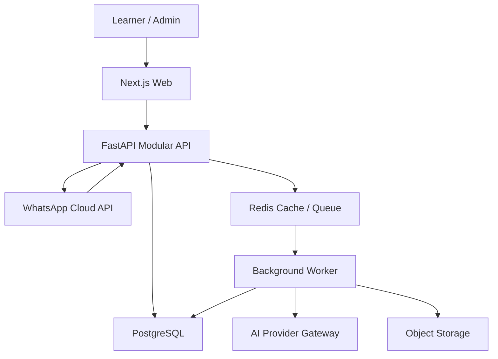

# Kasoma MVP System Architecture

| Field | Value |
|---|---|
| Version | 1.3.0 |
| Architecture style | Modular monolith with asynchronous workers |
| Deployment target | Cloud-neutral OCI containers; production provider selected before beta |

## 1. Architecture goals

- Deliver the complete MVP in 12 weeks.
- Keep domain boundaries clear without premature microservices.
- Use one assessment, grading and mastery implementation across web and WhatsApp.
- Make content versions and learning evidence auditable.
- isolate model providers behind interfaces;
- support pilot scale without a redesign.

## 2. Chosen stack

| Layer | Decision |
|---|---|
| Monorepo | pnpm workspaces + Turborepo |
| Web | Next.js 15+, React, TypeScript strict mode, Tailwind CSS and an accessible component layer |
| API | Python 3.12+, FastAPI, Pydantic v2, SQLAlchemy 2 and Alembic |
| Worker | Celery 5.6.x using Redis transport, wrapped behind `JobQueue` |
| Database | PostgreSQL 16+; `pgvector` enabled only for approved-content retrieval |
| Cache/queue | Local Redis in development; production managed Redis-compatible service selected with the cloud provider |
| Object storage | S3-compatible abstraction; MinIO locally; cloud adapter selected later |
| AI gateway | Provider-neutral interface using an OpenAI-compatible task contract; deterministic fake, Ollama/llama.cpp/vLLM and cloud adapters |
| Messaging | Meta WhatsApp Cloud API behind a `MessagingProvider` adapter |
| Authentication | Application-managed user records plus verified OTP and short-lived access/rotating refresh tokens |
| Observability | OpenTelemetry traces/metrics, structured logs and error reporting |
| CI/CD | GitHub Actions-compatible pipeline; container images; staged environments |

Application/domain code must not import AWS, Azure or GCP SDKs. Cloud-specific SDKs and infrastructure remain inside adapters and deployment modules selected through an ADR.

## 3. Repository layout

```text
kasoma/
  apps/
    web/                 # Next.js learner and admin application
    api/                 # FastAPI HTTP application
    worker/              # asynchronous job entry point
  packages/
    api-client/          # generated TypeScript client from OpenAPI
    ui/                  # shared accessible UI components
    config/              # lint/type/test configuration
    analytics-schema/    # versioned event schemas
  services/
    domain/              # Python domain modules if separated from API
  infra/
    containers/
    deployment/
  docs/
    product/
    specifications/
    decisions/ADR/
    implementation/
    runbooks/
  tests/
    contract/
    e2e/
```

Do not split deployable services during MVP unless load/isolation evidence and an approved ADR require it.

## 4. Backend modules

| Module | Responsibility | Must not own |
|---|---|---|
| Identity | users, identifiers, verification, sessions, consent | mastery or content logic |
| Curriculum | subjects, topics, concepts, competencies, prerequisites | learner state |
| Content | item authoring, versions, rubrics, rights, workflow | scoring learner attempts |
| Assessment | diagnostics, revision sessions, item delivery, attempts | AI-provider calls directly |
| Grading | deterministic and rubric grading orchestration | content publication |
| Mastery | evidence processing, estimates, recommendation | UI formatting |
| Messaging | WhatsApp webhooks, state and outbound delivery | duplicate learning logic |
| Analytics | event validation and delivery | operational source of truth |
| Administration | roles, flags, configuration and audit views | bypassing domain permissions |

Modules communicate through explicit service interfaces and domain events. Database tables may share one physical database, but cross-module writes must go through the owning service.

## 5. Runtime topology



## 6. Request patterns

### Synchronous

Use for authentication, content reads, session creation, answer submission and deterministic grading. A transaction shall persist the attempt, grade and outbox event atomically where feasible.

### Asynchronous

Use for AI-assisted grading, embeddings, imports, analytics export and notifications. Jobs require idempotency keys, retry policy, dead-letter handling and a visible status.

### Transactional outbox

Domain events that trigger mastery or messaging are inserted in the same database transaction as the source change. A worker publishes/processes the outbox. This prevents a saved answer with a missing mastery update.

## 7. Data ownership and consistency

- PostgreSQL is the source of truth.
- Redis is disposable cache/queue state, never the only copy of learner progress.
- Analytics storage is not the operational source of truth.
- Object storage contains media; database records contain ownership, hash and access metadata.
- Mastery updates are eventually consistent after AI-assisted grading but synchronous after deterministic grading where latency permits.
- Client state is never authoritative for scores, roles, consent or mastery.

## 8. Authentication and authorization

- Access token target lifetime: 15 minutes.
- Rotating refresh token target lifetime: 30 days; hashed at rest; family revocation on reuse.
- OTP: six digits or equivalent entropy, 10-minute expiry, one-time use, attempt and send limits.
- Roles: `LEARNER`, `CONTENT_AUTHOR`, `ACADEMIC_REVIEWER`, `ADMIN`, `SUPPORT_READONLY`.
- Resource ownership and role are checked server-side on every protected operation.
- Admin and reviewer accounts require stronger authentication before production launch.

## 9. Environments

| Environment | Purpose | Data rule |
|---|---|---|
| Local | Developer execution | synthetic fixtures only |
| Test/CI | automated tests | ephemeral synthetic data |
| Staging | integration, content review, pilot rehearsal | synthetic or explicitly approved pilot data |
| Production | learner service | restricted access and monitored changes |

No production database clone may be used locally. Seed data must be license-safe and synthetic.

## 9.1 Production provider, region and recovery

- AWS, Azure and GCP remain eligible production providers.
- The provider/region decision must be approved by the end of Week 8, before real-world beta data, using the decision matrix in `17_Local_Development_and_Provider_Portability.md`.
- Prefer an African region with required generally available services, acceptable Uganda latency, contractual safeguards and viable cost.
- Zone/multi-zone deployment is required where the chosen generally available SKU supports it and cost remains inside the approved pilot budget.
- PostgreSQL point-in-time backup retention: 35 days.
- Maintain an encrypted same-geography or otherwise approved recovery copy.
- MVP targets: RPO ≤24 hours and RTO ≤8 hours.
- Core learner databases, object storage and Redis must not be scattered across regions for convenience.
- AI inference may use a different approved provider/region only with minimized pseudonymous task data and an updated DPIA/cross-border record.

## 9.2 Local-first development

The default developer environment runs without paid external calls:

- PostgreSQL + pgvector in Docker;
- Redis in Docker;
- MinIO for object storage;
- Mailpit for email capture;
- fake SMS/WhatsApp adapters with signed webhook fixtures;
- deterministic `FakeModelProvider` for automated tests;
- host-native Ollama on the 16 GB M4 Mac Mini for individual local inference, with containers reaching it at `host.docker.internal:11434`;
- a 4B–8B quantized model as the normal local profile; a 12B quantized model is a manual stretch profile, not a required developer baseline;
- Google AI Studio/Gemini free-tier access only through the explicit, sanitized `gemini-free-eval` profile described in document 18;
- vLLM for a shared GPU server when available.

CI must not possess production AI, SMS, email or WhatsApp credentials and must fail if a normal test attempts external network inference.

## 10. Reliability patterns

- Idempotency keys on answer submission, session creation where retries are likely, and WhatsApp webhook processing.
- Optimistic locking/version columns on mutable content and configuration.
- Timeouts and circuit breakers around AI and messaging providers.
- Exponential retry only for transient failures; deterministic validation failures are not retried.
- Dead-letter queue with operator visibility.
- Feature flags for AI short-text grading, WhatsApp outbound messages and new recommendation versions.
- Database migrations must be backward-compatible across one deployment window.

## 11. Observability

Every request/job shall carry `correlation_id`, `actor_id` when authenticated, `channel`, and safe domain identifiers. Never log OTPs, tokens, full learner answers, guardian contact details or raw model prompts containing personal data.

Required dashboards:

- latency/error/availability;
- answer-to-feedback time;
- job failures and dead letters;
- grade method/confidence/fallback rates;
- content flags by item version;
- AI tokens/cost and messaging cost;
- mastery update lag;
- WhatsApp webhook duplicates/failures.

## 12. Deployment gate

Production deploy requires passing migrations, unit/integration/contract tests, security scan, OpenAPI compatibility check, smoke test and a rollback plan. Direct manual production code changes are prohibited.
