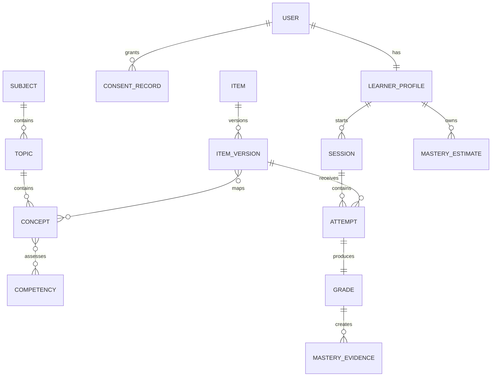

# Kasoma Domain and Data Model

| Field | Value |
|---|---|
| Version | 1.0.0 |
| Store | PostgreSQL 16+ |
| Identifier policy | UUIDv7/UUID primary keys; public opaque IDs |

## 1. Core domains



## 2. Identity entities

### `users`

`id`, `status`, `display_name`, `birth_date` or `age_band`, `locale`, `timezone`, `created_at`, `updated_at`, `deleted_at`.

### `user_identifiers`

`id`, `user_id`, `type` (`EMAIL|PHONE`), `normalized_value_encrypted`, `lookup_hash`, `verified_at`, `is_primary`, timestamps. Unique on `(type, lookup_hash)` for active records.

### `auth_sessions`

Hashed refresh token identifier/family, device metadata minimized, issued/expiry/revoked timestamps. Raw tokens are never stored.

### `consent_records`

`user_id`, `subject_user_id`, `consent_type`, `basis`, `guardian_relationship`, encrypted/minimized guardian contact where required, `policy_version`, `granted_at`, `revoked_at`, evidence metadata.

### `learner_profiles`

`user_id`, `level_id`, onboarding state, selected subject IDs, goals, accessibility preferences and channel preferences.

## 3. Curriculum entities

- `levels`: includes only S4 as active in MVP.
- `subjects`: Mathematics and Physics active.
- `topics`: six frozen clusters after Week 1.
- `concepts`: hierarchical concepts with syllabus reference.
- `competencies`: controlled vocabulary such as recall, interpretation, application, problem-solving.
- `concept_prerequisites`: directed edge with strength and reviewer evidence.
- `concept_competencies`: applicable mappings.

Cycles in `concept_prerequisites` are prohibited by validation.

## 4. Content entities

### `items`

Stable identity independent of edits: `id`, `subject_id`, owner team, created timestamp.

### `item_versions`

Immutable once approved: `id`, `item_id`, sequential `version`, `status`, prompt blocks, response type, difficulty band, expected time, language, channel suitability, answer specification, explanation blocks, source/provenance, rights status, author, timestamps and content hash.

### `item_mappings`

Versioned mappings to topic, concept and competency. Includes primary mapping flag and cognitive demand.

### `rubrics` and `rubric_criteria`

Rubric version, maximum score, criteria, point values, acceptable evidence, common errors and prohibited inference. One approved rubric version is pinned to an approved short-text item version.

### `misconceptions`

Controlled ID, concept, description, detection rule/evidence, remediation content and reviewer.

### `item_relationships`

`source_item_version_id`, `target_item_version_id`, relation (`EQUIVALENT|PREREQUISITE|REMEDIATION|VARIANT`), confidence and reviewer. Equivalent items must not be text duplicates.

### `content_reviews`

Reviewer, decision, checklist result, comments, timestamps. Approval requires reviewer different from author.

## 5. Learning entities

### `assessment_sessions`

`id`, `learner_id`, type (`DIAGNOSTIC|REVISION|REASSESSMENT`), channel, subject, optional topic, status, plan version, recommendation reason, started/completed timestamps and expiry.

State transitions:

```text
PLANNED -> ACTIVE -> COMPLETED
                 -> ABANDONED
                 -> EXPIRED
```

### `session_items`

Ordered item-version assignment with selection reason, served timestamp and role (`BASELINE|PRACTICE|RETRY|REASSESSMENT`). Assignment is fixed once served.

### `attempts`

Immutable submission: learner, session item, channel, normalized response, encrypted/raw response only where required, submitted time, duration, hint use, idempotency key and client metadata minimized.

### `grades`

`attempt_id`, normalized score `[0,1]`, raw/max points, method (`DETERMINISTIC|RUBRIC_MODEL|HUMAN`), rubric version, model/prompt version where applicable, confidence, status, structured evidence, feedback reference and timestamps.

Grade status: `PENDING|GRADED|LOW_CONFIDENCE|REVIEW_REQUIRED|OVERRIDDEN`. Overrides append a new grade revision and never delete the original.

### `mastery_evidence`

Immutable evidence produced from one grade for one skill dimension: concept, competency, item difficulty, score, independence weight, timestamp, algorithm version and unique `(attempt_id, concept_id, competency_id)`.

### `mastery_estimates`

Current projection keyed by learner/concept/competency: score `[0,1]`, confidence `[0,1]`, evidence count, effective weight, last evidence time, algorithm version and calculated time. History is stored in `mastery_estimate_history`.

### `recommendations`

Candidate scores, selected target, human-readable reason, algorithm version, input snapshot/hash, status and outcome session.

## 6. Messaging entities

- `channel_links`: user, provider, encrypted external identifier, status, linked/opted-out timestamps.
- `link_codes`: hashed code, user, expiry, consumed timestamp.
- `inbound_messages`: provider ID unique, safe parsed type, received/processed status.
- `conversation_states`: current WhatsApp flow and session pointer with expiry.
- `outbound_messages`: template/type, delivery status, provider ID, retry count; avoid storing full sensitive message bodies.

## 7. Operations entities

- `content_flags`: item version, attempt optional, category, text, reporter, priority, status, resolution.
- `audit_log`: actor, action, target, timestamp, correlation ID, safe before/after hashes or structured diff.
- `outbox_events`: type, aggregate, payload, version, attempts, published timestamp.
- `data_subject_requests`: export/deletion type, identity verification, state and completion evidence.
- `feature_flags` and `system_configuration`: versioned, environment scoped and audited.

## 8. Required invariants

1. Approved item versions are immutable.
2. Historical attempts always reference a concrete item version.
3. Every grade references the answer/rubric version actually used.
4. Mastery evidence is append-only and idempotent per attempt/skill.
5. Mastery estimates can be rebuilt entirely from valid evidence.
6. Draft or retired content cannot be newly assigned.
7. Authors cannot approve their own content.
8. One provider message ID is processed once.
9. One link code is consumed once and expires.
10. Personal identifiers use normalized lookup hashes and encrypted values.

## 9. Indexing and partition guidance

- Index attempts by learner/time and session item.
- Index approved item versions by subject/topic/concept/competency/difficulty/channel suitability.
- Partial indexes for active/approved statuses.
- Unique indexes for idempotency keys, provider message IDs and content `(item_id, version)`.
- Use JSONB only for bounded versioned structures such as prompt blocks or grade evidence; frequently queried relationships remain normalized.
- No table partitioning is required for MVP; revisit after measured growth.

## 10. Deletion/anonymization

Deletion workflow removes authentication identifiers, channel links and direct profile data, then anonymizes permitted learning records using a non-reversible replacement identity. Records that must be retained for rights, security or financial obligations follow the approved retention schedule. Analytics events must never be the only location of personal data requiring deletion.

## Reviewed hint persistence (migration 0009)

`hint_uses` stores append-only learner/assignment linkage, ordered level (1–3), phase
(`BEFORE_ANSWER` or `AFTER_ANSWER`) and UTC timestamp. Text remains in the immutable
approved item-version document. Unique assignment/level and eligibility triggers
prevent skipped levels, future-item disclosure and diagnostic hints. Receipt linkage
supports exact retry boundaries. Attempts freeze before-answer count/highest level;
mastery evidence and safe outbox metadata bind to those values. Post-answer usage
cannot rewrite attempts, grades or evidence. Legacy evidence without highest level
retains its original input hash. See [ADR-022](../decisions/ADR/022-reviewed-hints.md).

## Unseen reassessment persistence (migration 0010)

The `REASSESSMENT` session kind requires exactly one assignment and a topic. The
append-only `reassessments` record binds a unique original revision attempt to the
child session and selected version, relationship basis, elapsed seconds, selection
snapshot and input hash. Guards enforce ownership, distinct stable items, all-time
unseen delivery, primary skill/difficulty and one-item linkage. Original grades and
new mastery evidence remain separate. Active-topic uniqueness applies to REVISION,
allowing a reassessment to coexist with its source session.

Optional content-document `equivalents` claims pin another approved version plus
confidence (0–1), under the claim-bearing version's immutable content hash and
independent review records. Selection records the exact claim/review IDs or the
explicit same-skill/difficulty fallback basis. No automatic relationship inference
or retrospective evidence rewrite occurs. See [ADR-023](../decisions/ADR/023-unseen-reassessment.md).
