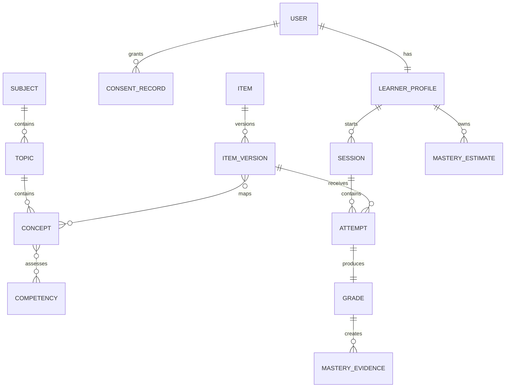

# Kasoma Domain and Data Model

| Field | Value |
|---|---|
| Version | 1.0.0 |
| Store | PostgreSQL 16+ |
| Identifier policy | UUIDv7/UUID primary keys; public opaque IDs |

## 1. Core domains



## 2. Identity entities

### `users`

`id`, `status`, `display_name`, `birth_date` or `age_band`, `locale`, `timezone`, `created_at`, `updated_at`, `deleted_at`.

### `user_identifiers`

`id`, `user_id`, `type` (`EMAIL|PHONE`), `normalized_value_encrypted`, `lookup_hash`, `verified_at`, `is_primary`, timestamps. Unique on `(type, lookup_hash)` for active records.

### `auth_sessions`

Hashed refresh token identifier/family, device metadata minimized, issued/expiry/revoked timestamps. Raw tokens are never stored.

### `consent_records`

`user_id`, `subject_user_id`, `consent_type`, `basis`, `guardian_relationship`, encrypted/minimized guardian contact where required, `policy_version`, `granted_at`, `revoked_at`, evidence metadata.

### `learner_profiles`

`user_id`, `level_id`, onboarding state, selected subject IDs, goals, accessibility preferences and channel preferences.

## 3. Curriculum entities

- `levels`: includes only S4 as active in MVP.
- `subjects`: Mathematics and Physics active.
- `topics`: six frozen clusters after Week 1.
- `concepts`: hierarchical concepts with syllabus reference.
- `competencies`: controlled vocabulary such as recall, interpretation, application, problem-solving.
- `concept_prerequisites`: directed edge with strength and reviewer evidence.
- `concept_competencies`: applicable mappings.

Cycles in `concept_prerequisites` are prohibited by validation.

## 4. Content entities

### `items`

Stable identity independent of edits: `id`, `subject_id`, owner team, created timestamp.

### `item_versions`

Immutable once approved: `id`, `item_id`, sequential `version`, `status`, prompt blocks, response type, difficulty band, expected time, language, channel suitability, answer specification, explanation blocks, source/provenance, rights status, author, timestamps and content hash.

### `item_mappings`

Versioned mappings to topic, concept and competency. Includes primary mapping flag and cognitive demand.

### `rubrics` and `rubric_criteria`

Rubric version, maximum score, criteria, point values, acceptable evidence, common errors and prohibited inference. One approved rubric version is pinned to an approved short-text item version.

### `misconceptions`

Controlled ID, concept, description, detection rule/evidence, remediation content and reviewer.

### `item_relationships`

`source_item_version_id`, `target_item_version_id`, relation (`EQUIVALENT|PREREQUISITE|REMEDIATION|VARIANT`), confidence and reviewer. Equivalent items must not be text duplicates.

### `content_reviews`

Reviewer, decision, checklist result, comments, timestamps. Approval requires reviewer different from author.

## 5. Learning entities

### `assessment_sessions`

`id`, `learner_id`, type (`DIAGNOSTIC|REVISION|REASSESSMENT`), channel, subject, optional topic, status, plan version, recommendation reason, started/completed timestamps and expiry.

State transitions:

```text
PLANNED -> ACTIVE -> COMPLETED
                 -> ABANDONED
                 -> EXPIRED
```

### `session_items`

Ordered item-version assignment with selection reason, served timestamp and role (`BASELINE|PRACTICE|RETRY|REASSESSMENT`). Assignment is fixed once served.

### `attempts`

Immutable submission: learner, session item, channel, normalized response, encrypted/raw response only where required, submitted time, duration, hint use, idempotency key and client metadata minimized.

### `grades`

`attempt_id`, normalized score `[0,1]`, raw/max points, method (`DETERMINISTIC|RUBRIC_MODEL|HUMAN`), rubric version, model/prompt version where applicable, confidence, status, structured evidence, feedback reference and timestamps.

Grade status: `PENDING|GRADED|LOW_CONFIDENCE|REVIEW_REQUIRED|OVERRIDDEN`. Overrides append a new grade revision and never delete the original.

### `mastery_evidence`

Immutable evidence produced from one grade for one skill dimension: concept, competency, item difficulty, score, independence weight, timestamp, algorithm version and unique `(attempt_id, concept_id, competency_id)`.

### `mastery_estimates`

Current projection keyed by learner/concept/competency: score `[0,1]`, confidence `[0,1]`, evidence count, effective weight, last evidence time, algorithm version and calculated time. History is stored in `mastery_estimate_history`.

### `recommendations`

Candidate scores, selected target, human-readable reason, algorithm version, input snapshot/hash, status and outcome session.

## 6. Messaging entities

- `channel_links`: user, provider, encrypted external identifier, status, linked/opted-out timestamps.
- `link_codes`: hashed code, user, expiry, consumed timestamp.
- `inbound_messages`: provider ID unique, safe parsed type, received/processed status.
- `conversation_states`: current WhatsApp flow and session pointer with expiry.
- `outbound_messages`: template/type, delivery status, provider ID, retry count; avoid storing full sensitive message bodies.

## 7. Operations entities

- `content_flags`: item version, attempt optional, category, text, reporter, priority, status, resolution.
- `audit_log`: actor, action, target, timestamp, correlation ID, safe before/after hashes or structured diff.
- `outbox_events`: type, aggregate, payload, version, attempts, published timestamp.
- `data_subject_requests`: export/deletion type, identity verification, state and completion evidence.
- `feature_flags` and `system_configuration`: versioned, environment scoped and audited.

## 8. Required invariants

1. Approved item versions are immutable.
2. Historical attempts always reference a concrete item version.
3. Every grade references the answer/rubric version actually used.
4. Mastery evidence is append-only and idempotent per attempt/skill.
5. Mastery estimates can be rebuilt entirely from valid evidence.
6. Draft or retired content cannot be newly assigned.
7. Authors cannot approve their own content.
8. One provider message ID is processed once.
9. One link code is consumed once and expires.
10. Personal identifiers use normalized lookup hashes and encrypted values.

## 9. Indexing and partition guidance

- Index attempts by learner/time and session item.
- Index approved item versions by subject/topic/concept/competency/difficulty/channel suitability.
- Partial indexes for active/approved statuses.
- Unique indexes for idempotency keys, provider message IDs and content `(item_id, version)`.
- Use JSONB only for bounded versioned structures such as prompt blocks or grade evidence; frequently queried relationships remain normalized.
- No table partitioning is required for MVP; revisit after measured growth.

## 10. Deletion/anonymization

Deletion workflow removes authentication identifiers, channel links and direct profile data, then anonymizes permitted learning records using a non-reversible replacement identity. Records that must be retained for rights, security or financial obligations follow the approved retention schedule. Analytics events must never be the only location of personal data requiring deletion.

## Reviewed hint persistence (migration 0009)

`hint_uses` stores append-only learner/assignment linkage, ordered level (1–3), phase
(`BEFORE_ANSWER` or `AFTER_ANSWER`) and UTC timestamp. Text remains in the immutable
approved item-version document. Unique assignment/level and eligibility triggers
prevent skipped levels, future-item disclosure and diagnostic hints. Receipt linkage
supports exact retry boundaries. Attempts freeze before-answer count/highest level;
mastery evidence and safe outbox metadata bind to those values. Post-answer usage
cannot rewrite attempts, grades or evidence. Legacy evidence without highest level
retains its original input hash. See [ADR-022](../decisions/ADR/022-reviewed-hints.md).

## Unseen reassessment persistence (migration 0010)

The `REASSESSMENT` session kind requires exactly one assignment and a topic. The
append-only `reassessments` record binds a unique original revision attempt to the
child session and selected version, relationship basis, elapsed seconds, selection
snapshot and input hash. Guards enforce ownership, distinct stable items, all-time
unseen delivery, primary skill/difficulty and one-item linkage. Original grades and
new mastery evidence remain separate. Active-topic uniqueness applies to REVISION,
allowing a reassessment to coexist with its source session.

Optional content-document `equivalents` claims pin another approved version plus
confidence (0–1), under the claim-bearing version's immutable content hash and
independent review records. Selection records the exact claim/review IDs or the
explicit same-skill/difficulty fallback basis. No automatic relationship inference
or retrospective evidence rewrite occurs. See [ADR-023](../decisions/ADR/023-unseen-reassessment.md).

## Learner flag persistence (migrations 0011–0012)

`content_flags` pins attempt, learner reporter, stable item and exact version with a
unique attempt/category scope and immutable source binding. Comment and current
resolution are encrypted. Mutable priority/status/owner require a monotonically
checked revision and append-only `content_flag_history` metadata; actor-bound
`content_flag_receipts` protect retries. Database guards require valid source bindings,
independent reviewer ownership, history, terminal resolution and a retention date
24 calendar months after resolution. Reopening clears the terminal resolution/date.
Safe audit and content outbox events commit atomically. No grade/mastery row changes.
Production retention/anonymization jobs remain a separate required gate; no destructive
flag deletion is exposed. See [ADR-025](../decisions/ADR/025-learner-flags.md).

Migration 0012 explicitly requires a terminal retention deadline, closing SQL CHECK
null semantics without rewriting the already applied initial migration.

## Multiple-choice persistence (migration 0013)

The existing attempts.response JSON stores `{type: MULTIPLE_CHOICE, choice_ids: [A,C]}`
with a null choice_id. A bounded structured-response constraint preserves the prior
numeric shape and accepts only sorted, unique, nonempty sets of 1–8 uppercase IDs.
The assignment trigger also requires MULTIPLE_CHOICE on the pinned approved version
and membership of every selected ID in its options. Legacy choice/numeric rows and
content/grade hashes remain unchanged. Reviewed correct_choice_ids is versioned under
the existing content hash. Grade, mastery, hint and outbox atomicity/immutability remain.
Use forward fixes with compatible readers; no destructive downgrade of learner evidence.
See [ADR-026](../decisions/ADR/026-multiple-choice.md).

## Data-request intake persistence (migration 0014)

Identity owns data_subject_requests: server-derived account, EXPORT/DELETE kind,
recent OTP authentication time, verification method, creation time and explicit
SIX_YEARS_AFTER_COMPLETION retention policy. One pending request per account/kind
is enforced. data_request_reviews links a single
independent administrator claim; status derives from the presence of this row.
Actor/key-scoped data_request_receipts protect retry identity across create/claim.
Original intake, review and receipt fields are append-only; no free text, credentials or contact details are copied.
SQL guards check verification age, policy, independent ADMIN claims and timestamps.
Audit and safe identity-outbox records commit atomically.

Migration 0015 extends export completion as below. Deletion/anonymization and six-year
retention expiry with narrowly scoped legal holds remain pending, including reconciliation
of immutable historical evidence.
No indefinite retention, broad delete bypass or general identity impersonation is
approved. See [ADR-027](../decisions/ADR/027-data-request-intake.md).


## Owned export persistence (migration 0015)

Nullable completed_at, retention_due_at and export_digest are the only permitted
request mutations, exactly once for EXPORT, with matching artifact metadata. All other
request fields remain immutable. A partial unique index limits pending requests per
account/kind while allowing a new request after completion. Review/receipt evidence
remains immutable and contains no export body.

`data_exports` holds request_id, encrypted_payload, SHA-256 digest, created_at and
expires_at exactly 24 hours later. Deferred constraints require atomic completion;
completion requires the exact six-calendar-year retention deadline. Artifact updates
and deletion before expiry are prohibited. The bounded sweeper deletes expired copies
only, retaining request/audit/outbox evidence. Download authorization checks expiry even
before a sweep runs. Database backups retain their separate approved 35-day policy.
See [ADR-028](../decisions/ADR/028-owned-data-exports.md).


## Deletion-impact inventory (ADR-029; no schema migration)

A claimed pending DELETE request may be inspected by its independent ADMIN reviewer.
`services/deletion_preview.py` counts linked identity, authentication, consent, learning,
request, export, flag and staff-provenance records using explicit predicates. Unbound
OTP challenges are attributed by a verified identifier lookup hash; another learner's
bound challenge is not attributed through that hash. Related staff sources may overlap
owned sources and require separate review. No stored data is decrypted or projected.

No erasure state, transformed identity, fabricated retention deadline or held-record
status is introduced. Existing audit_log stores only a metadata access event targeted
to the request. Shared rate buckets, logs, backups, arbitrary embedded references and
unimplemented channels remain explicit inventory limitations. Future deletion requires
record-specific legal holds, reviewed transforms/constraints and recovery evidence;
the preview is never an execution authorization.

## Specific-record legal holds (migration 0016; ADR-030)

`legal_holds` stores UUID id, parent DELETE request_id, record_type/id, decision_reference,
reason, created_by/at and finite expires_at. Nullable released_at/by/release_reference
are the only permitted update, together and exactly once while active. Scope, decision,
reason, creation evidence and expiry cannot be overwritten or extended. Multiple explicit
holds may reference one record. No account wildcard, arbitrary narrative or payload exists.
`legal_hold_receipts` binds actor_id/key to request_hash and hold_id; immutable retry evidence.

Database guards enforce an independent ADMIN claim on a pending DELETE request and
ownership of an existing consent, attempt, content flag or data request. Target rows are
key-share locked on insert. BEFORE DELETE guards reject active registered holds while
preserving existing immutability. `record_is_held(kind, target, at_time)` checks unreleased
holds at created_at <= time < expires_at; deletion guards use the database clock.
Scope/release evidence is retained with its parent request's six-year-after-completion
obligation, with no invented expiry while pending. Expiry/release ends preservation effect,
not evidence retention. Hold evidence deletion and receipt mutation remain prohibited.

The preview adds bounded active counts and hold/receipt inventory. No other immutable
constraint is relaxed and no UPDATE anonymization or deletion execution state is enabled.
Future processors must check holds transactionally with compatible locks, expand coverage
and retain the existing legal/privacy gates. The migration rollback policy is to disable
new routes while retaining evidence and protections, followed by a forward fix.
See [ADR-030](../decisions/ADR/030-record-legal-holds.md).

## Bounded import command outbox (ADR-032 / migration 0017)

`content_import_jobs` stores actor/key uniqueness, canonical request hash/correlation,
validated JSON payload, due/expiry timestamps, bounded attempts, terminal status and
safe result references. Row locks and actor locks serialize processing and duplicate
checks. Savepoints roll back every draft/audit/event before recording a failed attempt.
Immutable request metadata and terminal rows are guarded by database triggers. Payload
is cleared on completion/failure, with queued expiry at 24 hours. Minimal job metadata is
staff administrative provenance, included in deletion-impact review and subject to the
existing six-year-after-closure evidence policy; its retention processor remains pending.
`DraftDocument.source_locator` is additive; historical stored documents/hashes are not rewritten.

## Local channel linking (ADR-034 / migration 0018)

Additive tables: `link_codes`, `channel_senders`, `channel_links`, `inbound_messages`,
`outbound_messages`, `channel_mutation_receipts`. Unique actor/key codes and mutation receipts,
unique provider-message hashes, one bound sender and one link per learner enforce ownership.
Code and channel triggers prevent code resurrection, owner reassignment and stale revision writes.
The link UUID plus revision protects unlink across expiry/recreation. STOP retains ownership;
UNLINKED clears the encrypted identifier and permits explicit later rebinding.

Raw bodies, contact names and arbitrary message text are not stored. Persist keyed message/payload/
sender/code hashes, encrypted transient recipients and normalized commands/status. Clear transient
recipients/code hashes at terminal processing, expire code hashes at five minutes, code/mutation
receipts at 24 hours and transport/unlinked rows at 30 days in bounded batches. STOPPED links remain
bound account records; account erasure and channel legal-hold coverage are pending. Owned export
includes bound channel status/identifier and minimized actor-owned receipt metadata, excluding
unbound sender history. Deletion preview includes the new relational inventory without claiming
permission to erase or complete legal-hold coverage.

## Channel provenance foundation (ADR-037)

Migration 0019 extends the immutable `attempts.channel` constraint to WEB and WHATSAPP and adds
an insert guard requiring a five-item revision assignment with explicit WHATSAPP suitability.
Existing response-format, active-assignment, approved-version, ownership and append-only guards
remain in force. Historical evidence is not rewritten. Application capability checks additionally
reject rich/oversized questions before channel selection, serving or submission. Conversation
state and webhook-driven attempts remain pending.

## Local conversation state (ADR-038, migration 0020)

`conversation_states` holds one actor/link-revision-bound session pointer and expected outgoing
reply UUID per channel link, expiring 24 hours after activity. Menu topic UUIDs and question/grade
references are stored on outgoing rows; rendering rechecks current ownership, consent, enrollment
and approval. A database trigger guards conversation ownership and five-item revision shape.
Deleting an expired referenced outgoing receipt also removes its transient pointer by cascade.

Incoming structured replies store a bounded encrypted body only when intake can bind the provider
context to an active recipient/link and current sent menu/question. Worker validation repeats that
check and clears the encrypted field on terminal processing; queued replies expire at 24 hours.
Unbound text is not retained. STOP intake and web unlink remove the pointer and cancel pending
outbound messages, preserving shared assessment evidence. Owned exports and deletion previews
include minimized conversation state. Remaining channel holds/account erasure remain separate gaps.

`channel-transport-event.schema.json` records only event name, correlation UUID, channel, status
and schema version for worker intake/drain and wake-up failures. Message bodies and identifiers
are never operational event fields.

Migration 0020 also strengthens new-attempt channel checks for WEB resumes: the assigned version
must explicitly allow the submitted channel. Existing immutable attempts are untouched.

## Local channel operational indexes (ADR-039, migration 0021)

Add status/time indexes for incoming and outgoing message cohorts/oldest pending age, plus partial
indexes for accepted outgoing cohorts and feedback send timestamps. No new personal-data table,
retention category or learning evidence is introduced. Operational values are derived snapshots.

## Learning-record hold targets (migration 0022; ADR-043)

The hold record_type constraint also permits GRADE, MASTERY_EVIDENCE and MASTERY_HISTORY.
GRADE record_id is grades.attempt_id and ownership follows attempts.learner_id. Evidence uses
mastery_evidence.id/learner_id; history uses mastery_estimate_history.id with ownership through
its evidence row. Both service and SQL guard key-share lock targets and joined ownership rows.
New BEFORE DELETE guards preserve held records without removing any existing immutable trigger.

Scope remains one named record; related attempts, estimates and other evidence are not implicitly
held. Existing four target types and all decision/release/retention controls remain unchanged.
Coverage is still incomplete and no erasure or anonymization is enabled. See
[ADR-043](../decisions/ADR/043-learning-record-holds.md).

## Implemented reviewed-rubric boundary (ADR-044)

Migration 0023 adds rubrics(id = item_versions.id, maximum_points) and rubric_criteria keyed by
(rubric_id, criterion_id), with stable positions and explicit text, acceptable evidence, common
errors and prohibited inferences. The owning item supplies version number and review lifecycle.
Normalized material must exactly match the canonical document before IN_REVIEW/APPROVED and is
mutable only in DRAFT. SHORT_TEXT session assignment is rejected in SQL until learner integration
is approved. Existing objective documents/hashes are unchanged. See
[ADR-044](../decisions/ADR/044-reviewed-rubric-persistence.md) and
[verification](../implementation/E2_REVIEWED_RUBRICS_VERIFICATION.md).

## Exact accountability hold keys (ADR-045)

FLAG_HISTORY targets content_flag_history.id and follows content_flags.reporter_id.
DATA_REQUEST_REVIEW targets data_request_reviews.request_id and follows data_subject_requests.user_id.
Neither uses the staff actor as the requester ownership link. Migration 0024 extends the existing
registry/SQL ownership validation and adds DELETE guards; existing immutable rows/updates remain
protected. A hold does not cascade to the parent/siblings or clear erasure/retention gates.

## Candidate encrypted short-text persistence (ADR-050)

Migration 0032 is an additive, disabled-runtime integration candidate. Session items
pin an immutable grading_band_id; objective assignments cannot carry one. Encrypted
SHORT_TEXT attempt responses contain only type, ciphertext and the pinned rubric UUID.
Generated rubric foreign keys equal the item-version UUID. At commit, every such
attempt must have its immutable receipt and durable grading work.

Definitive rubric grades retain a bounded authenticated encrypted result plus a
confidential quote-free points/confidence/criterion/version summary. SQL checks every
pinned criterion and the total/score, then defers the work-terminal/publication/mastery
consistency check to commit. Pending and neutral work are not zero-point grades.
`attempt.saved` records durable intake; the first neutral terminal transition emits
`attempt.grade_unavailable` once, using the original correlation ID. Neither event
contains answer text or model output. Existing whole-record attempt/grade holds preserve
encrypted payloads; owned exports decrypt only after current authorization and sealing.

Normal startup has no report or safety authority and defaults to disabled. The reviewed
rubric alone cannot enable assignment. The candidate's SQL replacement in synthetic tests,
engineering verification and remaining expert-review gates are described in
[ADR-050](../decisions/ADR/050-short-text-pending-and-eligibility.md) and
[the flow checklist](../implementation/E4_SHORT_TEXT_FLOW_IMPLEMENTATION.md).


## Independent expert review candidate (ADR-051, migration 0033)

Publication rows retain immutable global ordinals and original global-publication-v1
policy. New RUBRIC_MODEL publications use short-text-audit-release-unit-v1 with a
session/band ordinal; audit assignment is the union of first/every-tenth global and
session publication. Counters allow additional sampling while retaining the global
minimum. Old rows/ordinals are not rewritten.

`grading_audit_reviews` binds one immutable completion to its assignment, current
independent reviewer, exact pinned criterion-point map and closed critical category.
SQL derives agreement, allocates a per-band completion ordinal and atomically advances
`grading_review_counters`. Last 100 completed reviews (ordered by completion ordinal)
control sticky disablement; pending tasks are not successful reviews. Any critical
error or exact*10 < completed*9 disables the band under the publication lock. Good
later reviews cannot re-enable it. Completion time cannot predate its assignment,
band update or prior completed review, or exceed database time.

The nonpersonal completion aggregate cannot reset. Personal reviews are inventoried,
owned exports are minimized/sealed and exact holds derive ownership through attempts.
No destructive retention transform is introduced; answer text stays in the original
encrypted attempt. Normal short-text selection remains disabled pending release gates.


### Terminal channel receipt holds (ADR-055 candidate)

Migration 0034 extends legal_holds.record_type with CHANNEL_INBOUND_RECEIPT and
CHANNEL_OUTBOUND_RECEIPT, targeting original message UUIDs only after transient
material has been cleared and explicit actor ownership is known. No new table,
payload snapshot or data column. Existing record/receipt metadata and finite
release/expiry remain. Live/queued/unbound state and other channel kinds are unsupported.

Receipt UUIDs cannot change. While held, inbound terminal rows cannot be rewritten;
outbound core fields/ownership stay fixed while existing monotonic delivery callbacks
may update lifecycle status/time/reason. SQL independently validates and locks the
eligible source. Hold creation is bounded by database time; an ahead-of-database claim
fails closed until clock alignment permits a valid nonfuture hold.

Source DELETE and retention predicates use database wall clock, including deleting
transactions begun before a new hold. Active held IDs are excluded before batch LIMIT;
existing FK dependencies remain while unrelated eligible receipts continue to expire.
No active hold remains after all finite decisions end, so normal30-day cleanup resumes.
New-kind creation defaults disabled until all readers support the extended enum; the
existing ADMIN page advertises available kinds. Accountability metadata policy and
incomplete deletion/preservation coverage remain unchanged. See ADR-055/evidence.

Forward migration 0035 corrects no-op comparison through canonical to_jsonb rows, supporting the
existing JSON menu column without transforming it. Menu array order remains significant,
core rewrites stay forbidden and registered0034 holds/replay survive the upgrade.


### Legacy hold evaluation clock (ADR-056 candidate)

Forward0036 changes four existing DELETE wrappers to evaluate record_is_held at database
wall clock, covering generic id, grade attempt_id, request-review request_id and
publication attempt_id. The explicit at_time predicate remains unchanged for historical
queries. No enum, source data, retention policy, permission or append-only guard changes.
This corrects a measured old-transaction boundary and does not enable erasure.

## Audit activity sampling (ADR-058 candidate)

Forward migration 0037 adds `ix_audit_activity_window(created_at,id)` to audit_log
for newest bounded time-window sampling. It changes no row, audit trigger, source
identity, lifecycle or retention. Only fixed SQL-classified category literals cross
the service read boundary; no individual audit fields are projected to the API.

## Private channel evidence format (ADR-057 first increment)

Explicit approval covers bounded synthetic implementation. The offline format in
`services/channel_preservation_format.py` permits exactly the ADR-057 link and
conversation evidence allowlists. A separate binding contains snapshot/request/owner,
source kind/link/revision and an opaque observed-version value. Canonical UTC JSON
is authenticated with purpose- and binding-separated Fernet encryption using the
existing identity key and HKDF-SHA256. Bounds are 2,048 plaintext and 4,096 ciphertext
bytes. Private models are strict/frozen and representations omit their fields.

This increment adds no table or migration and persists nothing. The format does not
establish source ownership, freshness, observed-version generation or permission to
capture/decrypt. Those belong to the next atomic authorized transaction, independent
SQL guards and finite cleanup. No operational channel row is frozen or copied yet;
STOP/unlink and ordinary expiry retain their existing behavior. See
[verification](../implementation/E8_CHANNEL_PRESERVATION_FORMAT_VERIFICATION.md).

## Synthetic channel capture candidate (ADR-057, 0038)

The default-disabled candidate adds conversation state_version from a noncycling bigint
sequence on every INSERT/UPDATE; supplied values are overwritten, rollback gaps are
allowed and reinsertion receives a fresh value. Existing channel-link revision already
increments on every UPDATE and remains unchanged. No conversation UUID is invented.

`channel_preservation_snapshots` keeps immutable source kind/link/revision, optional
conversation state version, opaque observed version, parent request and capturing actor/
time. Owner derives from the request. `channel_preservation_bodies` holds only bounded
ciphertext; `channel_preservation_disposals` holds immutable snapshot/time accountability.
None references operational channel rows. Initial capture must commit ciphertext and
an exact active finite decision together. SQL independently checks current independent
claim, source ownership/version/availability and effective STOP barrier.

Bodies cannot update or reappear after disposal. Cleanup excludes active exact decisions
before its100-row bound, locks eligible bodies with SKIP LOCKED and removes ciphertext
with a disposal receipt. Metadata follows the existing six-years-after-request-completion
policy, with no invented completion for pending requests. Accountability expiry remains
pending. Source cleanup, STOP/unlink and contact/code disposal remain independent.

The preview inventories metadata, encrypted bodies and disposal receipts separately;
bodies use ACTIVE_EXACT_PRESERVATION_ONLY. Existing export projection excludes this
internal evidence. LEGAL_HOLD_COVERAGE_INCOMPLETE and execution=false remain. Full
candidate acceptance is pending; see [ADR-057](../decisions/ADR/057-minimized-channel-preservation-proposal.md).
